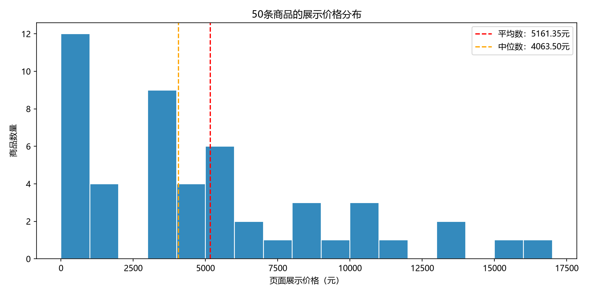

# scraping-to-analysis

Python 数据采集与分析学习项目：使用 Scrapling 采集数据、pandas 清洗统计、Matplotlib 绘制图表。

## 项目内容

- `scrape_quotes.py`：采集名言练习站，自动翻页并保存 `all_quotes.csv`。
- `analyze_laptops.py`：读取 50 条笔记本电脑样本，检查价格、填充价格说明、标记同名商品，生成统计表和图表。
- `taobao_laptops_50.csv`：分析使用的原始样本，来自手动提供的商品列表 HTML，经 Scrapling 离线提取；本项目未提供自动访问淘宝的脚本。
- `taobao_laptops_50_detail_links.csv`：保留原链接，并根据商品 ID 整理标准详情网址；没有联网验证最终跳转。
- `analysis_output/`：脚本生成的清洗数据、价格统计和三张图。
- 其他 CSV、TXT 和 PNG 文件：学习过程中保存的练习结果。

## 安装

以下命令在项目目录的 PowerShell 中运行。依赖版本来自本项目已验证的 Python 3.11 环境。

```powershell
py -3.11 -m venv .venv
.\.venv\Scripts\python.exe -m pip install -r requirements.txt
```

无需激活虚拟环境。当前两个脚本均不需要浏览器；如另外使用 Scrapling 浏览器抓取功能，再运行 `.\.venv\Scripts\scrapling.exe install`。

## 运行

采集练习站名言（需要网络）：

```powershell
.\.venv\Scripts\python.exe .\scrape_quotes.py
```

分析本地商品数据（无需联网）：

```powershell
.\.venv\Scripts\python.exe .\analyze_laptops.py
```

分析结果保存在脚本所在目录的 `analysis_output` 文件夹。输入 CSV 支持 UTF-8 和 GB18030（兼容中文 Windows/Excel 导出的 CSV），输出统一使用带 BOM 的 UTF-8。重复运行会更新输出，无需关闭图表弹窗；在 Excel 中打开的输出文件需先关闭，避免占用。

## 分析示例

当前样本共 50 条，平均展示价格约 5161.35 元，中位数为 4063.50 元。两条同名记录仅标记待核查，未删除。




统计仅描述当前搜索样本的页面展示价格，不代表销量或整体市场。商品可能包含不同配置、优惠和补贴条件，不能仅凭标题推断配置，也不能把不同条件下的价格直接当作同款比较。

采集练习请控制请求频率，遵守目标网站的访问规则。样本价格和链接可能随时间变化。
